# CampusMart AI — Architecture Documentation

This document explains the complete technical architecture of CampusMart AI. It is derived strictly from the CampusMart AI Final Architecture Specification and must remain consistent with it. No AWS services, features, or architectural patterns beyond that specification are introduced here.

---

## Table of Contents

1. [Architectural Principles](#1-architectural-principles)
2. [System Overview](#2-system-overview)
3. [AWS Services and Responsibilities](#3-aws-services-and-responsibilities)
4. [Frontend Architecture](#4-frontend-architecture)
5. [Authentication Architecture](#5-authentication-architecture)
6. [Role-Based Access Control (RBAC)](#6-role-based-access-control-rbac)
7. [API Architecture](#7-api-architecture)
8. [Lambda Architecture](#8-lambda-architecture)
9. [DynamoDB Architecture](#9-dynamodb-architecture)
10. [S3 and Image Upload Architecture](#10-s3-and-image-upload-architecture)
11. [Rekognition — Image Analysis](#11-rekognition--image-analysis)
12. [Listing Creation Workflow](#12-listing-creation-workflow)
13. [Marketplace Browse/Search Workflow](#13-marketplace-browsesearch-workflow)
14. [Wishlist Workflow](#14-wishlist-workflow)
15. [Reporting and Moderation Workflow](#15-reporting-and-moderation-workflow)
16. [EventBridge — Automation](#16-eventbridge--automation)
17. [SES — Email Notifications](#17-ses--email-notifications)
18. [CloudWatch — Monitoring](#18-cloudwatch--monitoring)
19. [Admin Architecture](#19-admin-architecture)
20. [Security Architecture](#20-security-architecture)
21. [Why Serverless](#21-why-serverless)
22. [Out-of-Scope Services](#22-out-of-scope-services)

---

## 1. Architectural Principles

CampusMart AI follows:

- Serverless architecture — no permanently running EC2 server
- Event-driven architecture for asynchronous workflows
- REST API architecture for client-server communication
- Component-based frontend architecture
- Managed AWS services wherever possible
- Role-based access control (RBAC), enforced server-side
- Separation of concerns between frontend, backend, and data layers
- API-first backend communication

---

## 2. System Overview

CampusMart AI is a serverless, full-stack marketplace built for college students. Students authenticate through Cognito, browse and manage listings through a Next.js frontend, and interact with a REST API backed by Lambda functions. Application data lives in DynamoDB, product images live in S3, and Rekognition screens uploaded images. EventBridge drives scheduled workflows such as listing expiry, SES delivers transactional email, and CloudWatch provides monitoring across the stack.

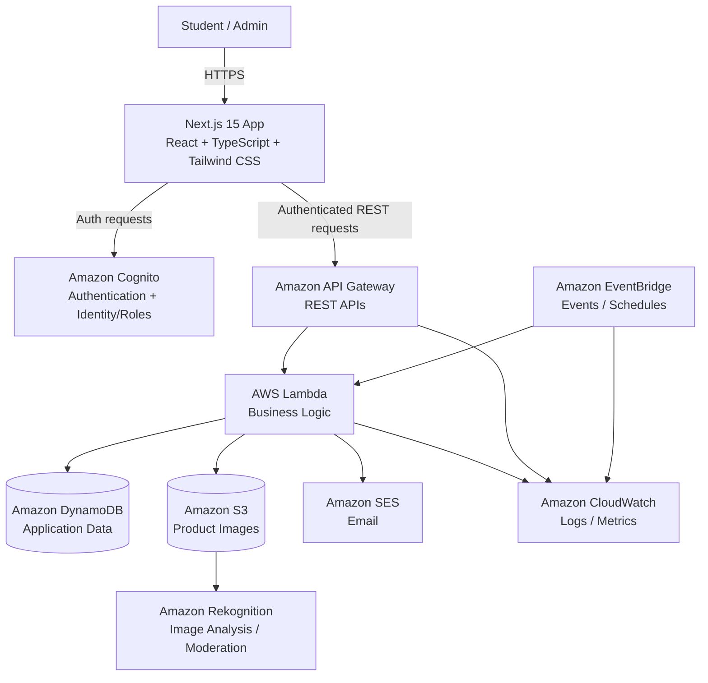

---

## 3. AWS Services and Responsibilities

| Service | Responsibility |
|---|---|
| Amazon Cognito | Authentication and user identity |
| Amazon API Gateway | REST API entry point |
| AWS Lambda | Backend business logic |
| Amazon DynamoDB | Scalable application data storage |
| Amazon S3 | Product image / object storage |
| Amazon Rekognition | Image analysis and moderation support |
| Amazon EventBridge | Scheduled and event-driven workflows |
| Amazon SES | Transactional email notifications |
| Amazon CloudWatch | Monitoring, logging, and observability |

Every service has exactly one clear responsibility. No service is used outside of this defined role.

---

## 4. Frontend Architecture

The frontend is a Next.js 15 application using the App Router, written in TypeScript, styled with Tailwind CSS, and built on shadcn/ui components.

Frontend responsibilities:

- Rendering pages and navigation
- User interaction and form handling
- Client-side validation
- Authentication state management
- Calling REST APIs
- Displaying loading and error states
- Responsive and accessible UI

The frontend does **not** contain core business logic — that belongs to the backend. All communication with AWS happens through authenticated REST API calls; the frontend never talks to DynamoDB, S3, or other AWS services directly.

---

## 5. Authentication Architecture

Amazon Cognito is solely responsible for authentication.

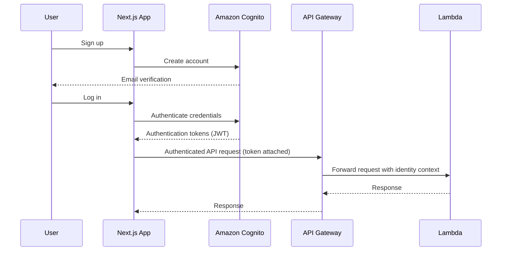

**Authentication vs. Authorization**

- **Authentication** answers: *"Who is this user?"* — handled entirely by Cognito.
- **Authorization** answers: *"What is this user allowed to do?"* — enforced in Lambda based on the user's role.

These two concerns are always treated separately in this architecture.

---

## 6. Role-Based Access Control (RBAC)

CampusMart AI defines two roles:

- **STUDENT**
- **ADMIN**

| Capability | Student | Admin |
|---|---|---|
| Browse / search listings | ✅ | ✅ |
| View product details | ✅ | ✅ |
| Create / edit / delete own listings | ✅ | — |
| Wishlist products | ✅ | — |
| Contact sellers | ✅ | — |
| Report listings | ✅ | — |
| Manage own profile | ✅ | — |
| Access admin dashboard | — | ✅ |
| View/manage users | — | ✅ |
| Moderate listings | — | ✅ |
| Review reports | — | ✅ |
| Take administrative action | — | ✅ |

**RBAC enforcement rule:** the frontend may hide unauthorized UI elements for a better user experience, but this is *never* treated as a security boundary. Every protected Lambda function independently verifies the authenticated user's identity and role before executing a privileged operation. A student must not be able to perform admin actions simply by calling the API directly.

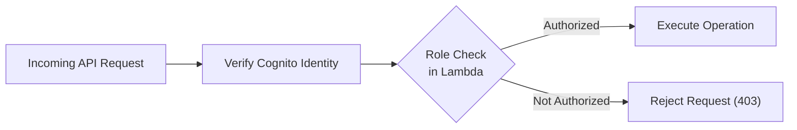

---

## 7. API Architecture

Amazon API Gateway exposes a REST API consumed by the Next.js frontend. Authentication is handled by Cognito; API Gateway routes authenticated requests to the appropriate Lambda function.

**Endpoint groups:**

- **Listings** — `GET /listings`, `GET /listings/{id}`, `POST /listings`, `PUT /listings/{id}`, `DELETE /listings/{id}`
- **Wishlist** — `GET /wishlist`, `POST /wishlist`, `DELETE /wishlist/{listingId}`
- **Profile** — `GET /profile`, `PUT /profile`
- **Reports** — `POST /reports`, `GET /reports/{id}`, `PUT /reports/{id}` (resolution/action taken)
- **Messages** — `GET /messages`, `POST /messages`, `GET /messages/{threadId}`, `POST /messages/{threadId}`
- **Notifications** — `GET /notifications`, `PATCH /notifications/{id}` (mark read)
- **Admin** — `GET /admin/users`, `PUT /admin/users/{id}` (account action), `GET /admin/listings`, `PUT /admin/listings/{id}` (moderation action), `GET /admin/reports`

`PUT /admin/listings/{id}` is a distinct, admin-only endpoint from the owner-scoped `PUT /listings/{id}` — ownership rules (Section 6) never apply to it, since only ADMIN-role requests are authorized to call it.

The full API contract (request/response schemas, status codes, error formats) is documented separately in `api.md`.

---

## 8. Lambda Architecture

AWS Lambda contains all backend business logic. Functions are organized by domain rather than as a single monolith:

- Listing functions
- User/profile functions
- Wishlist functions
- Report functions
- Message functions
- Admin functions
- Image processing functions
- Notification functions
- Expiry functions

Design principles for every Lambda function:

- **Stateless** — no reliance on local memory between invocations
- **Small** — one clear responsibility per function
- **Focused** — narrow, well-defined input/output contract
- **Independently testable**

Lambda accesses other AWS resources (DynamoDB, S3, SES) using scoped IAM permissions following least privilege.

---

## 9. DynamoDB Architecture

Amazon DynamoDB is the system of record for all application data. Core entities:

- Users
- Listings
- Wishlist records
- Reports
- Messages / Message threads
- Notifications
- Marketplace metadata

Representative listing attributes: `listingId`, `sellerId`, `title`, `description`, `price`, `category`, `condition`, image references, `status`, `createdAt`, `expiresAt`.

Representative user attributes: `userId`, `email`, `name`, `role`, profile information, `createdAt`.

Exact key design and access patterns are documented separately in `database.md`. No relational database or SQL architecture is used anywhere in this system.

---

## 10. S3 and Image Upload Architecture

Amazon S3 stores all uploaded product images. Images are **never** stored inside DynamoDB — only references to them.

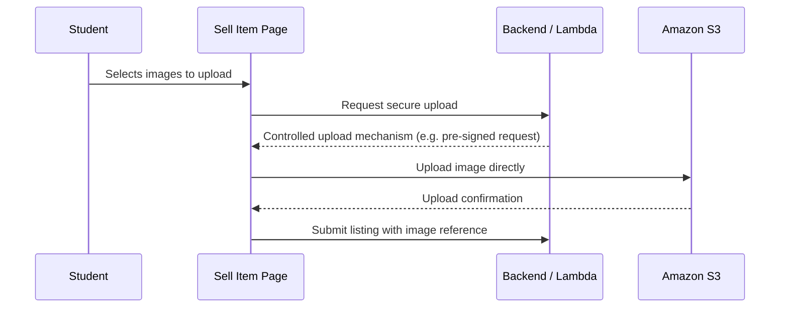

The architecture favors secure, direct browser-to-S3 uploads through a controlled upload mechanism issued by the backend, rather than routing raw image bytes through Lambda. The S3 bucket is never publicly writable.

---

## 11. Rekognition — Image Analysis

Amazon Rekognition analyzes uploaded product images to support automated moderation.

Purpose:

- Analyze uploaded product images
- Support automated image moderation
- Detect potentially inappropriate or unsuitable content
- Provide image-related metadata where useful

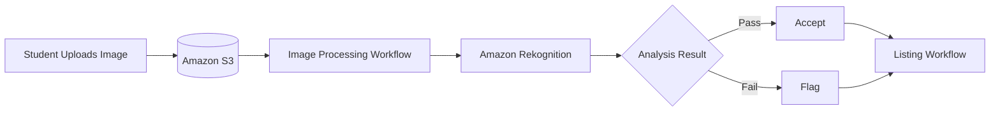

Rekognition is the sole image-analysis service used in this project; it is not replaced by or supplemented with Amazon Bedrock.

---

## 12. Listing Creation Workflow

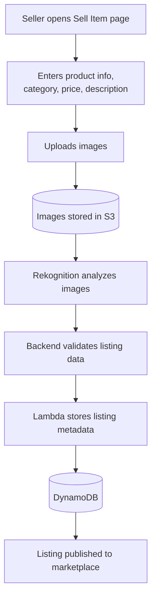

Simplified path: **Seller → Next.js Sell Page → S3 Image Upload → Rekognition → API Gateway → Lambda → DynamoDB → Published Listing**

---

## 13. Marketplace Browse/Search Workflow

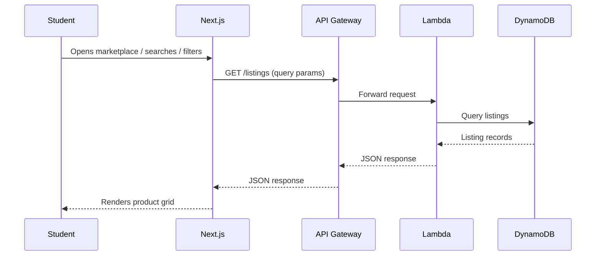

The frontend supports search, filtering, categories, product cards, product details, and wishlist actions. Search initially relies on DynamoDB-supported access patterns appropriate to the project's expected scale; OpenSearch is not introduced.

---

## 14. Wishlist Workflow

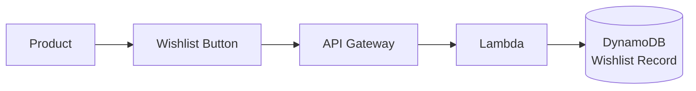

Students can add a listing, remove a listing, and view their wishlist.

---

## 15. Reporting and Moderation Workflow

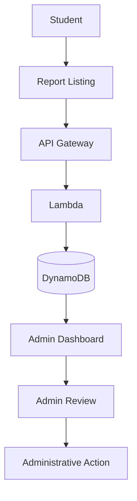

Possible administrative actions: keep listing, remove listing, flag listing, take action against account.

---

## 16. EventBridge — Automation

Amazon EventBridge drives scheduled and event-driven workflows. Its primary use case is **listing expiry**.

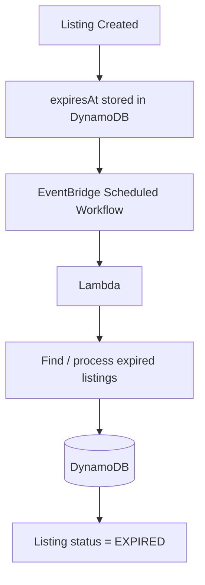

EventBridge may also handle other application events where asynchronous processing is appropriate, but it is never used for normal synchronous CRUD requests — those flow through API Gateway and Lambda directly.

---

## 17. SES — Email Notifications

Amazon SES delivers transactional emails, including listing expiry notifications, listing status notifications, seller notifications, and other important marketplace notifications.

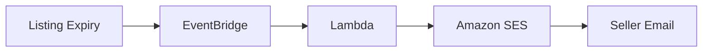

SES is purely an email delivery service; it holds no application business logic.

---

## 18. CloudWatch — Monitoring

Amazon CloudWatch provides monitoring and observability across the platform:

- Lambda execution, errors, and duration
- API Gateway errors
- Application logs
- Event-driven workflow failures
- Key application metrics

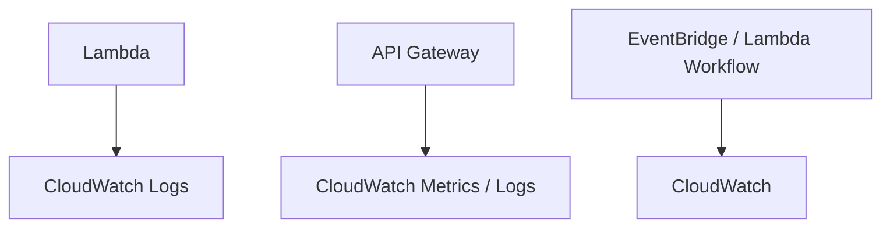

The application uses structured, meaningful logging so production issues can be diagnosed efficiently.

---

## 19. Admin Architecture

Admin frontend routes (`/admin`, `/admin/users`, `/admin/listings`, `/admin/reports`) are protected.

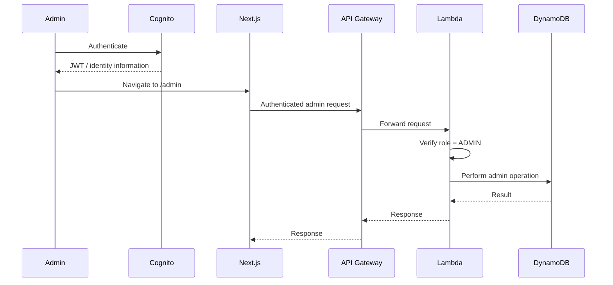

A normal student must not be able to perform admin operations, even by manually calling the API — role verification happens in Lambda on every admin request.

---

## 20. Security Architecture

- Cognito for authentication
- Backend-enforced authorization
- Role-based access control
- HTTPS everywhere
- IAM least privilege
- Private S3 storage
- Controlled image upload mechanism
- Client-side and server-side input validation
- Secure API access
- No secrets in frontend source code
- Environment variables for configuration
- CloudWatch monitoring

The frontend is never treated as a security boundary. All important authorization decisions happen server-side, in Lambda.

---

## 21. Why Serverless

CampusMart is a student marketplace with potentially variable traffic. Serverless provides automatic scaling, no server management, a pay-per-use execution model, reduced infrastructure maintenance, managed AWS infrastructure, and easy integration with event-driven workflows.

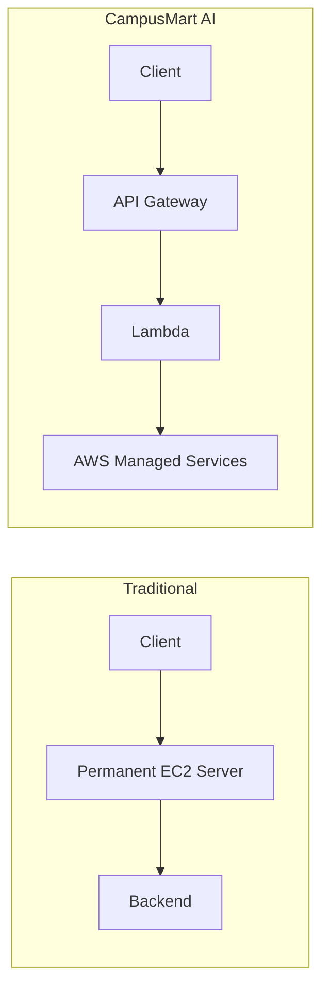

---

## 22. Out-of-Scope Services

The following are explicitly **not** part of the current architecture and are considered future enhancements only if explicitly requested later: Amazon Bedrock, Amazon OpenSearch, Amazon SNS, Amazon CloudFront, AWS WAF, Amazon ElastiCache, RDS, EC2, WebSocket API, ECS, EKS.

The current architecture remains focused on: **Cognito, API Gateway, Lambda, DynamoDB, S3, Rekognition, EventBridge, SES, CloudWatch.**
