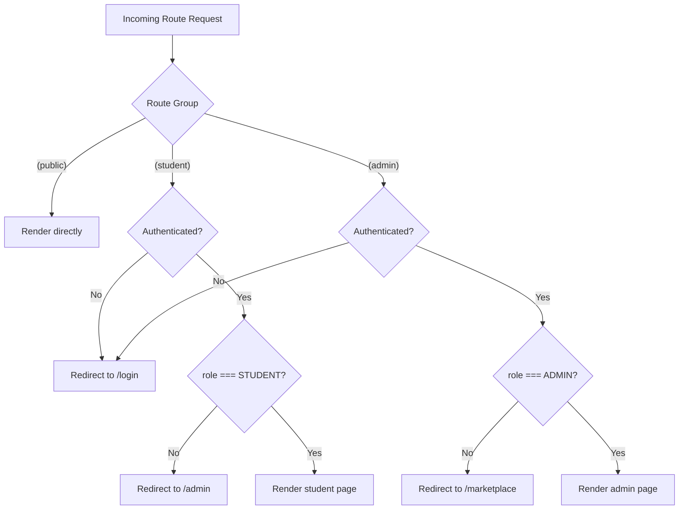

# CampusMart AI — Routing Documentation

This document defines the complete Next.js App Router structure for CampusMart AI, consistent with the CampusMart AI Final Architecture Specification (Section 24 — Frontend Pages), `docs/pages.md`, `docs/components.md`, and `docs/frontend.md`. No routes beyond those defined in the specification are introduced.

---

## Table of Contents

1. [Routing Model](#1-routing-model)
2. [Public Routes](#2-public-routes)
3. [Student Routes](#3-student-routes)
4. [Admin Routes](#4-admin-routes)
5. [Dynamic Routes](#5-dynamic-routes)
6. [Protected Routes](#6-protected-routes)
7. [Authentication Requirements](#7-authentication-requirements)
8. [RBAC Requirements](#8-rbac-requirements)
9. [Route Group Summary](#9-route-group-summary)
10. [Full Route Table](#10-full-route-table)

---

## 1. Routing Model

CampusMart AI uses the Next.js App Router exclusively (no Pages Router). Routes are organized into three **route groups** that reflect access level without affecting the resulting URL path:

- `(public)` — no authentication required
- `(student)` — authentication required, `role === "STUDENT"` only
- `(admin)` — authentication required, `role === "ADMIN"` only

Per `docs/architecture.md` (Section 6 — RBAC), the STUDENT and ADMIN roles are mutually exclusive at the route-group level: an ADMIN account does not use marketplace/student functionality, and a STUDENT account cannot reach `/admin/*`.

Each route group has its own `layout.tsx`, which is where authentication and role guarding is enforced at the UI layer (see [Section 6](#6-protected-routes)). Route groups are a purely organizational Next.js convention — they do not appear in the URL.

---

## 2. Public Routes

Public routes require no authentication. An already-authenticated user visiting `/login` or `/signup` is redirected to their role-appropriate landing page (`/marketplace` for students, `/admin` for admins).

| Route | Page | Purpose |
|---|---|---|
| `/` | Home | Landing page introducing CampusMart AI |
| `/login` | Login | Authenticate an existing user |
| `/signup` | Signup | Create a new student account |
| `/forgot-password` | Forgot Password | Reset a forgotten password |

**Layout:** `app/(public)/layout.tsx` — minimal shell (logo, footer), no authenticated navbar.

---

## 3. Student Routes

Student routes require authentication **and** the `STUDENT` role. An authenticated ADMIN account visiting a student route is redirected to `/admin`, consistent with the RBAC model in `docs/architecture.md` (Section 6), which does not grant admins the student capabilities (browsing, wishlist, messaging, reporting, own profile). All student routes assume the standard STUDENT capabilities defined in the architecture specification.

| Route | Page | Purpose |
|---|---|---|
| `/marketplace` | Marketplace | Browse and search active listings |
| `/marketplace/[listingId]` | Listing Detail | View full details of one listing |
| `/sell` | Sell Item | Create a new listing |
| `/listings` | My Listings | View/manage the student's own listings |
| `/listings/[listingId]/edit` | Edit Listing | Edit an owned listing |
| `/wishlist` | Wishlist | View saved listings |
| `/messages` | Messages | View message threads |
| `/messages/[threadId]` | Message Thread | View/send messages in one thread |
| `/notifications` | Notifications | View notifications |
| `/profile` | Profile | View/edit own profile |
| `/settings` | Settings | Manage account settings, sign out |

**Layout:** `app/(student)/layout.tsx` — renders `Navbar` (`variant="student"`) and enforces the authentication guard.

---

## 4. Admin Routes

Admin routes require authentication **and** the `ADMIN` role. A student who is authenticated but not an admin is redirected away from any `/admin/*` route.

| Route | Page | Purpose |
|---|---|---|
| `/admin` | Admin Dashboard | Marketplace overview summary |
| `/admin/users` | Admin Users | View/manage user accounts |
| `/admin/listings` | Admin Listings | View/moderate all listings |
| `/admin/reports` | Admin Reports | Review reports and take action |

**Layout:** `app/(admin)/admin/layout.tsx` — renders `Navbar` (`variant="admin"`) and `Sidebar`, and enforces both the authentication guard and the `ADMIN` role guard.

---

## 5. Dynamic Routes

CampusMart AI defines exactly three dynamic route segments, all within the `(student)` group:

| Route Pattern | Param | Type | Source |
|---|---|---|---|
| `/marketplace/[listingId]` | `listingId` | `string` | Listing identifier from DynamoDB |
| `/listings/[listingId]/edit` | `listingId` | `string` | Listing identifier, restricted to the listing's owner |
| `/messages/[threadId]` | `threadId` | `string` | Message thread identifier, restricted to thread participants |

**Conventions:**

- Every dynamic page types its params explicitly, e.g. `{ params: { listingId: string } }`.
- Dynamic pages fetch the corresponding resource on load and must handle a not-found or forbidden result distinctly (see `docs/pages.md` for each page's not-found/forbidden behavior).
- No additional dynamic segments (e.g., nested admin resource routes) exist in the current specification.

---

## 6. Protected Routes

Route protection is layered, consistent with `docs/frontend.md` (Section 6) and `docs/architecture.md` (Section 20 — Security Architecture: *"The frontend is not considered a security boundary"*).

**Layer 1 — Middleware (`middleware.ts`):**
- Runs on requests to any route inside `(student)` or `(admin)` groups.
- Checks for the presence of a valid session/token.
- Unauthenticated requests are redirected to `/login`.

**Layer 2 — Layout guards:**
- `(student)/layout.tsx` uses `useAuth()` to confirm `status === "authenticated"` **and** `user.role === "STUDENT"`; shows a loading state while auth resolves, redirects to `/login` if unauthenticated, and redirects an authenticated non-STUDENT (i.e., ADMIN) user to `/admin` rather than rendering student pages.
- `(admin)/admin/layout.tsx` performs the same authentication check, **plus** verifies `user.role === "ADMIN"`; a non-admin authenticated user is redirected to `/marketplace` (or shown a forbidden view) rather than to `/login`.

**Layer 3 — API-level enforcement (authoritative):**
- Every protected API call is independently verified server-side (Lambda checks identity and role from the token).
- A 401 response from any API call triggers the same redirect-to-`/login` behavior as the middleware/layout guard.
- A 403 response is rendered as a forbidden `ErrorState` — this can legitimately occur even when the UI has hidden the corresponding control, and the frontend must handle it gracefully rather than assume it's unreachable.

This three-layer approach means the frontend layers exist purely for user experience (avoiding flashes of unauthorized content, giving immediate redirects); the real authorization boundary is always server-side, per the architecture specification.

---

## 7. Authentication Requirements

| Route Group | Authentication Required? | Unauthenticated Behavior |
|---|---|---|
| `(public)` | No | Rendered normally; if already authenticated, redirected to role-appropriate landing page |
| `(student)` | Yes | Redirected to `/login` |
| `(admin)` | Yes | Redirected to `/login` |

Authentication state is sourced from Cognito via `lib/auth/auth-context.tsx` (see `docs/frontend.md`, Section 5). The frontend never infers authentication from local component state alone — it always derives it from the current Cognito session/token.

---

## 8. RBAC Requirements

| Route Group | Required Role | Enforcement |
|---|---|---|
| `(public)` | None | N/A |
| `(student)` | `STUDENT` only | Layout guard (Layer 2) + API-level checks (Layer 3) |
| `(admin)` | `ADMIN` only | Layout guard (Layer 2) + API-level checks (Layer 3) |

Within `(student)` routes, additional **ownership-level** authorization applies to specific pages and is enforced identically — UI hides/disables controls for non-owners, but the authoritative check happens server-side:

| Route | Ownership Rule |
|---|---|
| `/listings/[listingId]/edit` | Only the listing's `sellerId` may edit |
| `/messages/[threadId]` | Only thread participants may view/send messages |
| `/profile`, `/settings` | Always scoped to the authenticated user's own `userId` |

Per `docs/architecture.md` (Section 6 — RBAC), the frontend may hide unauthorized UI elements for usability, but this is never treated as a security boundary. All authorization decisions are ultimately enforced in Lambda.

---

## 9. Route Group Summary

```
app/
  (public)/     → No auth required
  (student)/    → Auth required + role === "STUDENT"
  (admin)/      → Auth required + role === "ADMIN"
```



---

## 10. Full Route Table

| Route | Group | Dynamic? | Auth Required | Role Required | Ownership Check |
|---|---|---|---|---|---|
| `/` | `(public)` | No | No | — | — |
| `/login` | `(public)` | No | No | — | — |
| `/signup` | `(public)` | No | No | — | — |
| `/forgot-password` | `(public)` | No | No | — | — |
| `/marketplace` | `(student)` | No | Yes | STUDENT | — |
| `/marketplace/[listingId]` | `(student)` | Yes (`listingId`) | Yes | STUDENT | — |
| `/sell` | `(student)` | No | Yes | STUDENT | — |
| `/listings` | `(student)` | No | Yes | STUDENT | Own listings only (server-scoped by `sellerId`) |
| `/listings/[listingId]/edit` | `(student)` | Yes (`listingId`) | Yes | STUDENT | Listing owner only |
| `/wishlist` | `(student)` | No | Yes | STUDENT | Own wishlist only |
| `/messages` | `(student)` | No | Yes | STUDENT | Own threads only |
| `/messages/[threadId]` | `(student)` | Yes (`threadId`) | Yes | STUDENT | Thread participants only |
| `/notifications` | `(student)` | No | Yes | STUDENT | Own notifications only |
| `/profile` | `(student)` | No | Yes | STUDENT | Own profile only |
| `/settings` | `(student)` | No | Yes | STUDENT | Own account only |
| `/admin` | `(admin)` | No | Yes | ADMIN | — |
| `/admin/users` | `(admin)` | No | Yes | ADMIN | — |
| `/admin/listings` | `(admin)` | No | Yes | ADMIN | — |
| `/admin/reports` | `(admin)` | No | Yes | ADMIN | — |

This table is exhaustive — no route exists outside of it, and no new routes should be added without an explicit update to the architecture specification.
